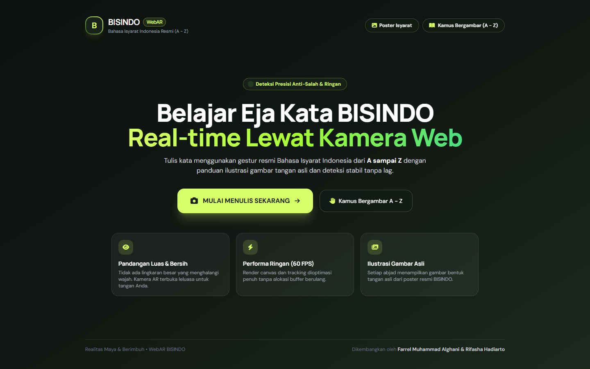
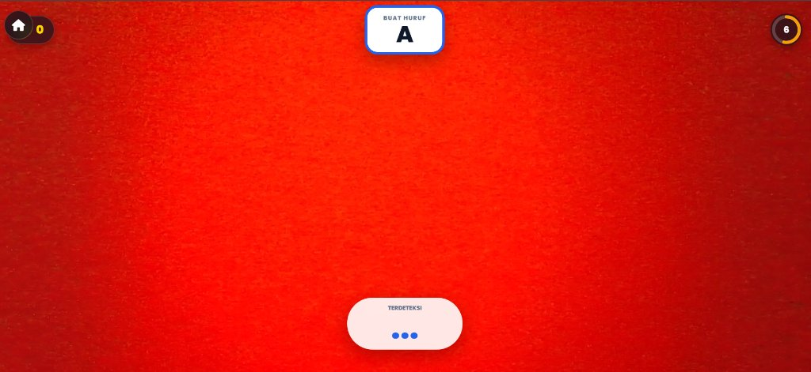
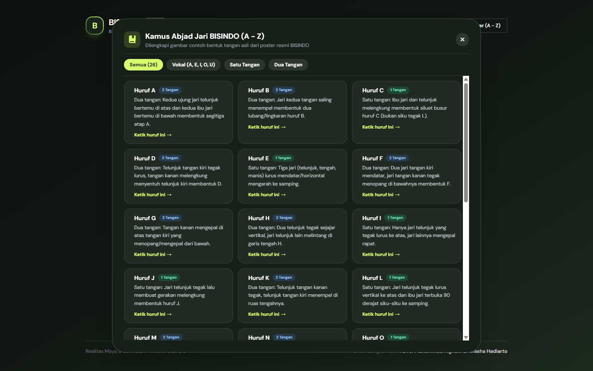
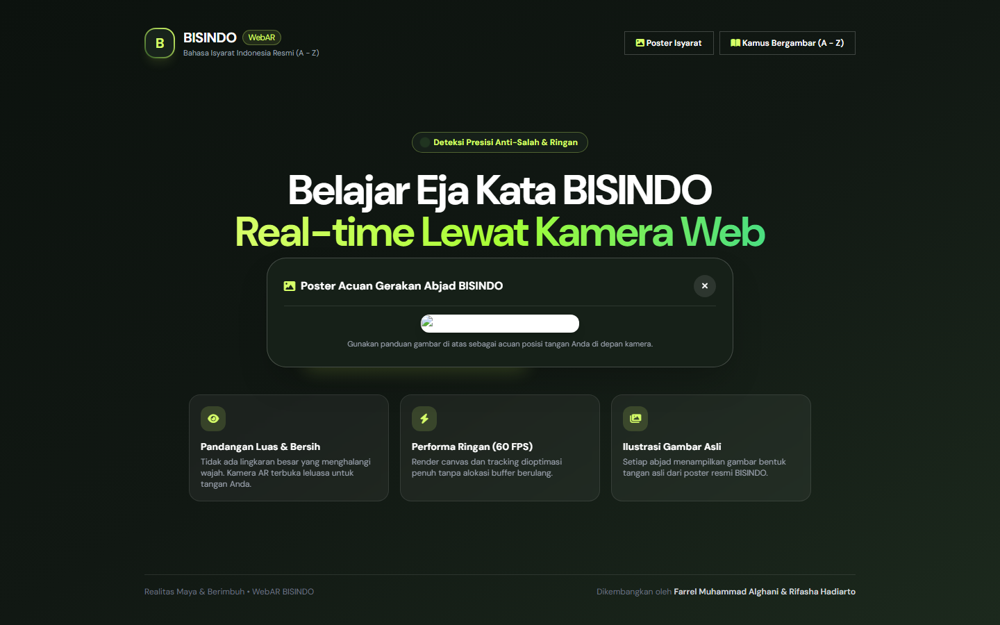
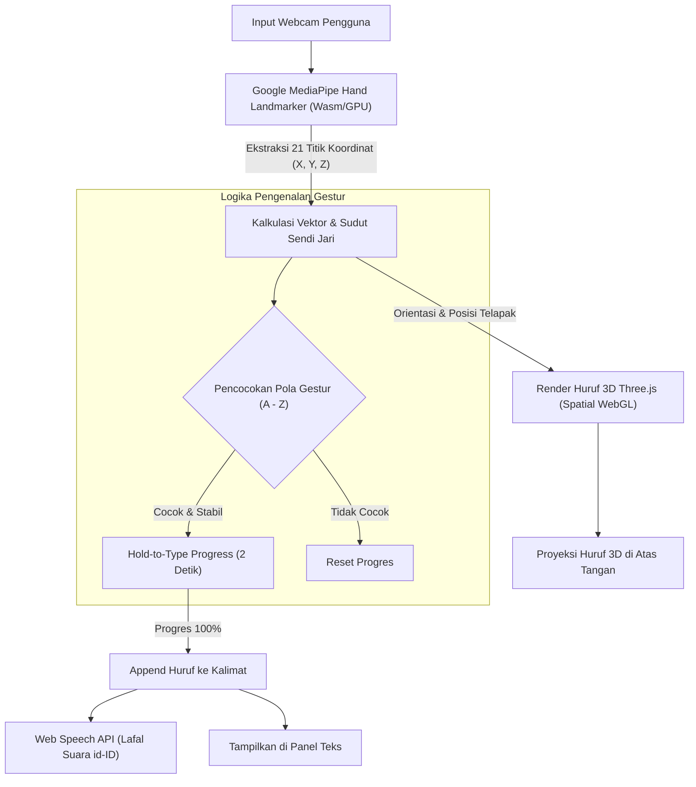

<div align="center">

# 🤟 WebAR BISINDO (Bahasa Isyarat Indonesia)

**Aplikasi Web-based Augmented Reality & Computer Vision modern untuk pembelajaran interaktif abjad jari Bahasa Isyarat Indonesia (A–Z) secara real-time langsung melalui web browser.**

[](index.html)
[](https://threejs.org/)
[](https://developers.google.com/mediapipe)
[](index.html)
[](index.html)
[](index.html)

[Tentang](#tentang) · [Fitur Utama](#fitur-utama) · [Tangkapan Layar](#tangkapan-layar) · [Alur Kerja](#alur-kerja) · [Teknologi](#teknologi) · [Mulai Cepat](#mulai-cepat) · [Kamus Isyarat A–Z](#kamus-isyarat-a-z) · [Pengembang](#pengembang)

</div>

---

## Tentang

**WebAR BISINDO** adalah media edukasi digital yang menggabungkan teknologi **Augmented Reality (AR)** berbasis web (*WebAR*) dan **Computer Vision** untuk mempermudah masyarakat mempelajari abjad jari Bahasa Isyarat Indonesia (**BISINDO**) dari huruf A hingga Z.

Aplikasi ini mendeteksi 21 titik sendi tangan (*hand landmarks*) secara presisi menggunakan webcam pengguna. Saat gestur tangan membentuk abjad yang benar, sistem memunculkan model huruf 3D interaktif yang melayang di atas telapak tangan secara real-time (*spatial tracking*), mengaktifkan indikator ketik otomatis (*hold-to-type*), serta melafalkan kata yang terbentuk menggunakan suara kecerdasan buatan (*Text-to-Speech*). 

Semua proses berjalan **100% di sisi klien (*client-side*)** tanpa memerlukan instalasi aplikasi tambahan maupun server komputasi eksternal.

---

## Fitur Utama

| Fitur | Deskripsi & Nilai Tambah |
| :--- | :--- |
| **Abjad Lengkap A – Z (1 & 2 Tangan)** | Mendukung pengenalan gestur satu tangan dan dua tangan khas BISINDO (seperti huruf A, B, F, G, M, N, P, S, T, X). |
| **Real-Time Hand Landmark Tracking** | Menggunakan Google MediaPipe Vision yang diakselerasi GPU via WebAssembly (Wasm) untuk mendeteksi 21 titik koordinat 3D per tangan pada frame rate tinggi (30–60 FPS). |
| **Interactive 3D Feedback (Three.js)** | Huruf 3D bertema neon/glassmorphism yang melayang dan mengikuti orientasi rotasi serta posisi tangan pengguna secara dinamis. |
| **Circular Hold-to-Type System** | Indikator progres melingkar (*circular progress SVG*) dengan durasi penahanan 2 detik untuk memastikan gestur stabil dan mencegah pengetikan ganda yang tidak disengaja. |
| **Text-to-Speech (Web Speech API)** | Pelafalan suara otomatis berbahasa Indonesia (`id-ID`) untuk setiap huruf yang terdeteksi serta fitur pembacaan seluruh kalimat yang telah disusun. |
| **Kamus & Panduan Isyarat A – Z** | Laci panduan interaktif (*drawer modal*) yang memuat ilustrasi visual dan instruksi posisi jari untuk seluruh huruf, lengkap dengan filter kategori (Semua, Vokal, 1 Tangan, 2 Tangan). |
| **Zero Installation & Zero Build** | Berjalan murni dengan file HTML/JS statis, tanpa perlu konfigurasi Node.js, `npm run build`, atau backend server. |

---

## Tangkapan Layar

<div align="center">

<table>
  <tr>
    <td width="50%"><br><sub><b>Antarmuka Utama</b> — Deteksi kamera real-time dengan overlay HUD glassmorphism</sub></td>
    <td width="50%"><br><sub><b>Hand Tracking</b> — 21 koordinat sendi tangan dan render huruf 3D melayang</sub></td>
  </tr>
  <tr>
    <td><br><sub><b>Kamus Panduan</b> — Referensi visual langkah pembentukan gestur jari A s/d Z</sub></td>
    <td><br><sub><b>Penyusun Kalimat</b> — Akumulasi kata dari gestur dan pelafalan audio otomatis</sub></td>
  </tr>
</table>

<sub><i>Catatan: Antarmuka dirancang responsif dan dapat dijalankan mulus pada perangkat smartphone maupun monitor komputer desktop.</i></sub>

</div>

---

## Alur Kerja



---

## Teknologi

| Komponen | Pustaka / API | Peran dalam Sistem |
| :--- | :--- | :--- |
| **Computer Vision** | Google MediaPipe Tasks Vision (v0.10.0) | Deteksi sendi jari, segmentasi gestur tangan via Wasm |
| **3D Rendering** | Three.js (v0.160.0) | Engine WebGL untuk geometri 3D, material neon, dan pencahayaan dinamis |
| **Audio Engine** | Web Speech API (`SpeechSynthesis`) | Sintesis suara bahasa Indonesia tanpa ketergantungan API pihak ketiga |
| **Styling & HUD** | Modern CSS3 & Tailwind CSS | Tata letak glassmorphism gelap (*Dark Theme* `#d7ff69` accent) |
| **Font & Ikon** | Google Fonts (Manrope, DM Sans, Fredoka), Font Awesome 6 | Tipografi modern dan ikonografi kontrol aplikasi |

---

## Mulai Cepat

Aplikasi ini dapat dijalankan secara instan tanpa perlu instalasi `npm` atau kompilasi bundler:

### 1. Jalankan Secara Lokal (VS Code)
1. **Clone repository ini:**
   ```powershell
   git clone https://github.com/farrelalghani/webar-bisindo.git
   Set-Location webar-bisindo
   ```
2. Buka folder proyek menggunakan **VS Code**.
3. Pasang ekstensi **Live Server** (Ritwick Dey) jika belum ada.
4. Klik kanan pada berkas `index.html` $\rightarrow$ pilih **"Open with Live Server"** (atau buka via `http://127.0.0.1:5500`).
5. Izinkan peramban mengakses **Webcam / Kamera**.

### 2. Deploy ke Hosting Statis (Gratis)
Karena aplikasi ini 100% *client-side*, Anda dapat langsung mempublikasikannya melalui:
* **GitHub Pages**: Buka menu *Settings $\rightarrow$ Pages $\rightarrow$ Deploy from a branch (main)*.
* **Vercel / Netlify**: Hubungkan repository GitHub dan klik deploy (tanpa build command, publish directory: root `/`).

---

## Kamus Isyarat A–Z

Sistem mengklasifikasikan abjad BISINDO ke dalam 3 kelompok utama:
* **Gestur 1 Tangan Statis**: C, E, I, L, O, R, U, V, Y.
* **Gestur 2 Tangan Interaktif**: A, B, D, F, G, H, J, K, M, N, P, Q, S, T, W, X, Z.
* **Gestur Dinamis**: Huruf dengan gerakan sapuan (*swipe gesture*) yang diverifikasi secara temporal.

---

## Pengembang

Proyek ini dikembangkan oleh:
* **[Farrel Muhammad Alghani](https://github.com/farrelalghani)** — *Computer Vision, Three.js 3D Rendering, & Frontend Architecture*
* **Rifasha Hadiarto** — *Gesture Research & User Interface Design*

*Program Studi Teknik Informatika, Universitas Komputer Indonesia (UNIKOM) Bandung.*

---

<div align="center">
<sub>Dibangun untuk mendukung inklusivitas komunikasi teman tuli menggunakan teknologi <b>WebAR</b> & <b>Google MediaPipe</b>.</sub>
</div>
